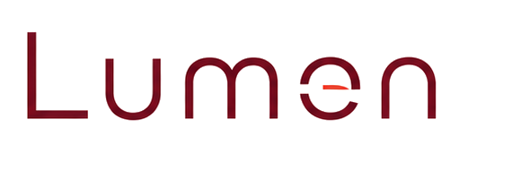

<div align="center">



### LOGO Tiger için modern, mobil uyumlu sipariş & stok yönetim ön yüzü

[](LICENSE)
[](https://www.php.net/)
[](https://www.microsoft.com/sql-server)
[](#gereksinimler)
[](#üretimde-kullanılıyor)

</div>

---

## English (Summary)

**Lumen** is a modern, mobile-friendly web front-end for businesses running **LOGO Tiger ERP**. It runs on top of your existing LOGO SQL Server database and provides a fast sales-terminal experience — order entry, customer/stock lookup, balances, cheques, multi-currency and reporting — in Turkish, on any device.

Lumen does **not** replace LOGO Tiger; it is a companion interface. Open source under the **MIT** license. First-time setup is a browser wizard (`/kurulum.php`), which also creates the tables Lumen needs from the scripts in `sql/`. To try it without a LOGO licence, `bash demo/kur.sh` starts a Docker demo (SQL Server + synthetic LOGO data + the app) — see [demo/README.md](demo/README.md).

**Used in production** at [AKEL Melamin](https://github.com/akel-melamin) — a Turkish melamine tableware manufacturer — for daily order entry, stock lookup and collections on a live LOGO Tiger installation. This repository is the de-branded, configurable open-source edition of that same codebase.

> ⚠️ Requires an existing **LOGO Tiger** installation on **Microsoft SQL Server** (with the `pdo_sqlsrv` PHP driver).

---

## Denemek için

Lumen, LOGO Tiger için bir yardımcı arayüzdür; v1.3.0'dan itibaren LOGO olmadan, kendi veritabanıyla ön muhasebe programı olarak da çalışır (**Bağımsız mod**). **PHP 8.2+**, `pdo_sqlsrv` ve **Microsoft SQL Server** gerekir.

**[Kurulum adımları](#kurulum)** · **[Sentetik demo veritabanı notları](#demo-veritabanı)** · [Kararlı sürüm v1.3.0](https://github.com/husodrn46/Lumen/releases/tag/v1.3.0) · [Kararlı sürüm kaynak kodunu indir](https://github.com/husodrn46/Lumen/archive/refs/tags/v1.3.0.zip)

**Bağımsız mod (v1.3.0):** LOGO'suz, kendi veritabanıyla ön muhasebe — mimari ve LOGO'dan geçiş: [docs/mimari/bagimsiz-lumen.md](docs/mimari/bagimsiz-lumen.md).

`v1.1.0-beta.1` (Faturalama BETA) ön sürümünün yerini v1.2.0 alır: Faturalama modülü bu sürümde de BETA ve varsayılan kapalıdır. Yükseltme: [CHANGELOG.md](CHANGELOG.md).

Hızlı deneme için `bash demo/kur.sh` Docker üzerinde SQL Server + sentetik LOGO verisi + uygulamayı kurar ([demo/README.md](demo/README.md)). Canlı şirket veritabanını deneme ortamı olarak kullanmayın.

## İçindekiler

- [Lumen Nedir?](#lumen-nedir)
- [Üretimde Kullanılıyor](#üretimde-kullanılıyor)
- [Özellikler](#özellikler)
- [Gereksinimler](#gereksinimler)
- [Kurulum](#kurulum)
- [Demo Veritabanı](#demo-veritabanı)
- [Yapılandırma](#yapılandırma)
- [Faturalama (BETA)](#faturalama-beta)
- [Kendi Markanız](#kendi-markanız)
- [Güvenlik](#güvenlik)
- [Katkıda Bulunma](#katkıda-bulunma)
- [Lisans](#lisans)

> 📖 **Kullanım kılavuzu** (personel ve işletme sahibi için, adım adım): [docs/kullanim/KILAVUZ.md](docs/kullanim/KILAVUZ.md)

## Lumen Nedir?

Lumen, **LOGO Tiger ERP** kullanan firmalar için tasarlanmış, web tabanlı bir **sipariş ve stok yönetim ön yüzüdür**. Verinin kaynağı LOGO'nun kendi SQL Server veritabanıdır; Lumen bu veritabanı üzerine hızlı, sade ve **mobil uyumlu** bir satış terminali arayüzü koyar.

Amaç: satış temsilcilerinin ve mağaza personelinin sipariş girişi, cari/stok sorgulama ve tahsilat gibi günlük işlemleri telefondan veya tabletten, LOGO'nun masaüstü istemcisine ihtiyaç duymadan yapabilmesi. LOGO bağımlılığı kalıcıdır — Lumen LOGO'nun yerini almaz, onu tamamlar.

## Üretimde Kullanılıyor

Lumen bir demo ya da kavram kanıtı değil: temelini oluşturan sistem **[AKEL Melamin](https://github.com/akel-melamin)** bünyesinde, LOGO Tiger üzerinde canlı bir kurulumda her gün gerçek sipariş, stok ve tahsilat işlemleri için kullanılıyor.

Bu depo, aynı kod tabanının **markasızlaştırılmış ve yapılandırılabilir** açık kaynak sürümüdür — firmaya özel değerler (ürün kodu ön eki, mağaza carisi, marka, yetkiler) koddan çıkarılıp ayar dosyalarına taşınmıştır. Yani üretimde denenmiş akışları, kendi LOGO veritabanınıza kurup kullanabilirsiniz.

## Özellikler

- 🧾 **Sipariş girişi** — hızlı çoklu satır, kademeli iskonto, KDV, döviz, koli/adet
- 👥 **Cari yönetimi** — bakiye, ekstre, Türkçe-duyarlı arama, cari işlemleri merkezi
- 📦 **Stok** — anlık miktar (LOGO view'larından), fiyat, birim/koli, barkod
- 💳 **Çek yönetimi** — giriş/çıkış/ciro, portföy takibi, çeke görsel ek
- 💱 **Döviz işlemleri** — çoklu kur, dövizli sipariş
- 💰 **Kasa** ve fatura yazdırma akışları
- 🧪 **Faturalama (BETA, varsayılan kapalı)** — sipariş → satış faturası, geri alınabilir · **KDV'siz çalışır; KDV mükellefi firmada kullanmayın** ([ayrıntı](#faturalama-beta))
- 📊 **Raporlar** — satış, cari yaşlandırma, kâr-zarar, çek, KDV, pazarlamacı performansı
- 🏷️ **Barkod / etiket** üretimi
- ✅ **Görev takibi**
- 🔔 **Bildirim kutusu** — görev atama/tamamlama/yorum, vadesi yaklaşan görev ve çekler, güvenlik ve ayar olayları
- 📱 **Mobil uyumlu + PWA** — telefona kısayol olarak eklenebilir
- 🎨 **Kişiselleştirme** — kullanıcı bazlı vurgu rengi, yazı boyutu, "müşteri yanında" gizli mod
- 🔐 **Rol bazlı yetki** — yönetici / personel / müşteri / entegrasyon (salt okunur API hesabı); kod bazlı ekran izinleri
- 🧙 **Kurulum sihirbazı** — tarayıcıdan DB bağlantısı + ilk yönetici
- 🖼️ **Kendi logonuz** — ayarlardan yükleyin

## Gereksinimler

- **LOGO Tiger** kurulu bir **Microsoft SQL Server** veritabanı
- **PHP 8.2+** ve `pdo_sqlsrv` sürücüsü ([Microsoft Drivers for PHP for SQL Server](https://learn.microsoft.com/sql/connect/php/download-drivers-php-sql-server))
  > 🔒 **Güvenlik:** Ekim 2026'daki kritik PHP açıkları (CVE-2026-109618, CVE-2026-109619 —
  > "PHP2Shell", kimlik doğrulamasız uzaktan kod çalıştırma) nedeniyle en az **8.2.35 / 8.3.36 /
  > 8.4.27 / 8.5.12** kullanın. Güncelleyene kadar `php.ini`'de `session.upload_progress.enabled=0`
  > yapıp web sunucusunu yeniden başlatın (Lumen bu özelliği kullanmaz; tam çözüm değildir).
  > Lumen yamasız PHP'yi kurulumda, yönetici ana sayfasında ve Sistem ve Yedek ekranında uyarır.
- Web sunucusu: IIS (FastCGI) veya Apache/nginx
- [Composer](https://getcomposer.org/) (bağımlılıklar için)

> **PHP 8.2 tabanı neden sabit:** `composer.json`daki
> `maennchen/zipstream-php: ~3.1.2` kısıtı kasıtlıdır. PhpSpreadsheet’in dolaylı
> bağımlılığı olan bu paket 3.2’den itibaren `php-64bit ^8.3` istiyor; sabitleme
> kaldırılırsa kilit dosyası PHP 8.3’e bağlanır ve 8.2 kurulumlarında
> `composer install` reddeder. Taban 8.3’e çıkarılırsa bu satır da kaldırılmalı.

## Kurulum

```bash
# 1) Depoyu alın
git clone https://github.com/husodrn46/Lumen.git
cd Lumen

# 2) Bağımlılıkları kurun
composer install

# 3) Web sunucunuzu bu klasöre yönlendirin (veya hızlı deneme):
php -S localhost:8000
```

Ardından tarayıcıdan **`http://localhost:8000/kurulum.php`** adresini açın ve sihirbazı izleyin:

1. **Veritabanı** — SQL Server adresi, veritabanı adı, kullanıcı/parola + firma/dönem numarası. Lumen bağlantıyı test edip `.env` ve `_baglanti_.inc` dosyalarını oluşturur.
2. **Yönetici** — LOGO'daki mevcut bir satış temsilcisi kodunu seçip parola belirleyin.

Kurulum bitince sihirbaz kilitlenir (`.installed`). Artık `giris.php` üzerinden giriş yapabilirsiniz.

> Elle kurulum: `.env.example` → `.env` ve `_baglanti_.inc.example` → `_baglanti_.inc` kopyalayıp değerleri doldurun.

### Yazma izinleri

Web sunucusu kullanıcısının (IIS: `IIS_IUSRS` / uygulama havuzu kimliği; Apache/nginx:
`www-data` vb.) şu klasörlere yazabilmesi gerekir: `logs/` (veya `LOG_ROOT`),
`database/` (ayarlar ve enflasyon verisi), `cek_ekleri/`, `gorev_ekleri/`, `tmp/`;
logo yüklemek için proje kökündeki `logo.png` / `icon.png`.

### Güncelleme

Yeni bir Lumen sürümüne geçtikten sonra (dosyaları güncelleyip `composer install`),
Lumen'e özel tabloları ve kolonları güncellemek için bir kez çalıştırın:

```bash
php scripts/sema_guncelle.php
```

Betikler idempotenttir (tekrar çalıştırmak güvenlidir) ve LOGO tablolarına dokunmaz.
Şema geride kalırsa yönetici ana sayfada uyarı görür.

## Demo Veritabanı

LOGO lisansınız olmadan denemek için Docker tabanlı hazır bir demo ortamı vardır:

```bash
bash demo/kur.sh
```

SQL Server, sentetik LOGO verisi (uydurma ürün/cari/sipariş/çek) ve uygulama birlikte
kurulur; <http://localhost:8088/giris.php> adresinden `YONETICI` / `demo1234` ile giriş
yapın. Ayrıntılar, diğer demo kullanıcıları ve testler: [demo/README.md](demo/README.md).

## Yapılandırma

| Dosya | Amaç |
|------|------|
| `.env` | DB bağlantısı, firma/dönem önekleri, mağaza carisi, log kökü (gizli — git'e girmez) |
| `_baglanti_.inc` | `.env`'i okuyan bağlantı katmanı |
| `_bilgi_.inc` | Özellik bayrakları ve varsayılanlar (döviz, çoklu depo, çek, mağaza satışı…) |
| `database/ayarlar.json` | Ayarlar ekranından kaydedilen değerler (`_bilgi_.inc` varsayılanlarının üzerine uygulanır; uygulama `_bilgi_.inc`'e yazmaz — gizli, git'e girmez, web'e kapalı) |

SQL Server bağlantısı Microsoft ODBC Driver 18 ile sertifika kimliğini varsayılan olarak doğrular (`AKL_DB_TRUST_CERT=0`). Yalnızca kimliğini başka yolla doğruladığınız yerel/kendinden imzalı bir sunucuda bu değeri bilinçli olarak `1` yapın. Şifrelemeyi açıkça yönetmek için `AKL_DB_ENCRYPT=0|1` kullanabilirsiniz.

Öne çıkan ayarlar: `MAGAZA_CARI` (mağaza hızlı satış carisi, 0 = kapalı), `$dovizlicalis`, `$cokludepo`, `$urun_kodu_oneki` (raporları belirli bir ürün kodu ön ekiyle sınırlar; boş = tüm ürünler). Loglar `.env` `LOG_ROOT` verilmezse `logs/` klasörüne yazılır.

## Faturalama (BETA)

Bir satış siparişini tek adımda LOGO satış faturasına çevirir: fatura + irsaliye +
stok çıkışı + cari borç tek transaction'da yazılır. Panelden **"Geri Al"** ile tamamen
iptal edilebilir (yalnız Lumen'in kestiği, muhasebeleştirilmemiş faturalar).

> ⛔ **KDV'siz çalışır** (`TOTALVAT = 0`); muhasebe fişi (ACCFICHE), e-fatura/e-arşiv ve
> satılan malın maliyeti oluşturulmaz. **KDV mükellefi bir firmada kullanmayın.**
> Fatura tutarı siparişin KDV'siz satır netleridir. Dövizli siparişler faturalanamaz.

Varsayılan olarak **kapalıdır**. Açmak için:

1. `php scripts/sema_guncelle.php` (M31 yetki kolonu ve `M_FATURA_LOG` tabloları).
2. Sistem Ayarları → Faturalama: **Faturalama Aktif**; seri ön eklerini (`LMF` / `LMI`)
   LOGO'nun kendi fatura/irsaliye serilerinden **farklı** olacak şekilde ayarlayın.
3. İlgili kullanıcılara **M31 (Faturalama)** yetkisi verin (yönetici otomatik alır).
4. Modül, LOGO'da kesilmiş geçerli bir TL satış faturasını şablon olarak kopyalar;
   veritabanında en az bir tane bulunmalıdır.

Önce bir test veritabanında deneyin.

## Zamanlanmış Görevler

İsteğe bağlı bakım betikleri (`scripts/`, web'den erişilemez). Windows Görev
Zamanlayıcı veya cron ile günde bir kez çalıştırın:

| Betik | Ne yapar |
|---|---|
| `php scripts/bos_taslak_temizle.php --uygula` | Lumen'de açılıp vazgeçilen, satırsız ve 3+ gündür dokunulmamış sipariş taslaklarını siler (yalnız Lumen'in açtıkları; LOGO'nun fişlerine dokunmaz). `--uygula` olmadan yalnız listeler. |
| `php scripts/bildirim_hatirlatici.php` | Vadesi yarın/bugün olan veya geçen görevleri atanana, vadesi 3 gün içinde olan portföy çeklerini çek yetkililerine bildirim kutusuna yazar (her olay bir kez). |
| `php scripts/log_hijyeni.php` | 10 MB'ı aşan log dosyalarını sıkıştırıp döndürür, 90 günden eski arşivleri siler (`--mb`, `--gun`, `--kuru`). |

Örnek (Windows): `php.exe C:\inetpub\lumen\scripts\log_hijyeni.php`

## Kendi Markanız

Ayarlar → **Marka / Logo** ekranından kendi yatay logonuzu ve uygulama ikonunuzu yükleyebilirsiniz (PNG/JPG/WEBP; sunucuda güvenli şekilde yeniden kodlanır). Vurgu rengi `--red` CSS değişkeniyle yönetilir.

## Güvenlik

- Tüm korumalı sayfalarda oturum + yetki denetimi (`kontrol.php`)
- Durum değiştiren isteklerde CSRF token
- Parolalar `password_hash` (bcrypt) ile saklanır
- Tüm sorgular PDO prepared statement; çıktıda `htmlspecialchars`
- Oturum sabitleme koruması, HttpOnly + SameSite=Strict çerezler
- Gizli bilgiler `.env` / `_baglanti_.inc` içinde tutulur ve `.gitignore` ile korunur
- Rol bazlı yetki her yazma ucunda (web + API); yönetici yetkisi yalnız yönetici tarafından verilebilir
- Özel cari kısıtı (müşteri gizleme) sayfalarda, raporlarda, yazdırma ve Excel çıktılarında uygulanır
- Zorla çıkış / parola değişikliği / pasifleştirme tüm oturumları, "Beni hatırla" ve API belirteçlerini iptal eder
- "Beni hatırla" belirteci her kullanımda yenilenir; kopyalanan çerez tespit edilip iptal edilir
- API belirteçleri veritabanında özet olarak saklanır, hesap başına tek canlı belirteç
- Giriş denemesi sınırı (IP ve hesap bazlı), saldırı modu (yalnız yerel ağ; API dahil)
- Ayarlar ekranı PHP dosyasına yazmaz (doğrulanmış JSON); ayar değişiklikleri denetim loguna düşer
- Excel çıktılarında formül enjeksiyonu engellenir; içerik güvenlik politikası (CSP) ve güvenlik başlıkları
- Sipariş satırında çakışma koruması; çek işlemlerinde mükerrer gönderim koruması

### Sunucu yapılandırması (önemli)

`.env` ve `_baglanti_.inc` **veritabanı parolanızı** içerir; web sunucusunun bu
dosyaları servis etmemesi gerekir. Depodaki hazır yapılandırmalar:

| Sunucu | Dosya | Durum |
|---|---|---|
| Apache | `.htaccess` | Depoda hazır gelir |
| IIS | `web.config` | Depoda hazır gelir |
| nginx | — | **Kendiniz eklemelisiniz** (nginx `.htaccess` okumaz) |

nginx kullanıyorsanız `server { … }` bloğunuza şunu ekleyin:

```nginx
location ~ /\.            { deny all; }          # .env, .git, .user.ini …
location ~* \.(inc|ini|sql|log|bak|example|db)$ { deny all; }
location ~* (^|/)web\.config$ { deny all; }
location ~* \.lumen\.gz$ { deny all; }
location ~* ^/composer\.(json|lock)$ { deny all; }
location ~ ^/(logs|tmp|sql|vendor|scripts|database|demo|tests|includes)/   { deny all; }
# Güvenlik başlıkları (web.config / .htaccess ile aynı)
add_header X-Content-Type-Options "nosniff" always;
add_header X-Frame-Options "SAMEORIGIN" always;
add_header Referrer-Policy "strict-origin-when-cross-origin" always;
add_header Content-Security-Policy "default-src 'self'; script-src 'self' 'unsafe-inline' 'unsafe-eval' cdn.tailwindcss.com cdnjs.cloudflare.com cdn.jsdelivr.net cdn.datatables.net code.jquery.com unpkg.com; style-src 'self' 'unsafe-inline' fonts.googleapis.com cdnjs.cloudflare.com cdn.jsdelivr.net cdn.datatables.net; font-src 'self' fonts.gstatic.com cdnjs.cloudflare.com data:; img-src 'self' data: blob:; connect-src 'self' cdn.datatables.net;" always;
# HTTPS kullanıyorsanız: add_header Strict-Transport-Security "max-age=31536000" always;
fastcgi_hide_header X-Powered-By;
```

Kurulumdan sonra `https://siteniz/.env` adresini tarayıcıda deneyin —
**403/404 dönmeli**, dosya içeriği görünmemelidir.

Güvenlik açığı bildirmek için lütfen bir **issue** açın (hassas konularda ayrıntıyı özel paylaşın).

## Katkıda Bulunma

Katkılar memnuniyetle karşılanır. Değişiklikten önce:

```bash
bash scripts/validate.sh     # sözdizim denetimi + sağlık taraması
php tests/birim/calistir.php  # birim testleri
php -l path/to/file.php       # tek dosya
```

Sayfa davranışını değiştiren işlerde demo ortamında duman testini çalıştırın
(`bash demo/kur.sh`, ardından [demo/README.md](demo/README.md) → Testler).

Yeni PHP dosyalarında `declare(strict_types=1);` kullanın, mevcut kod stiline uyun, sorgularda daima prepared statement tercih edin.

## Lisans

[MIT](LICENSE) © husodrn46

> "LOGO" ve "Tiger", LOGO Yazılım'ın tescilli markalarıdır. Lumen bağımsız, üçüncü taraf bir açık kaynak projesidir ve LOGO Yazılım ile herhangi bir bağı yoktur.
